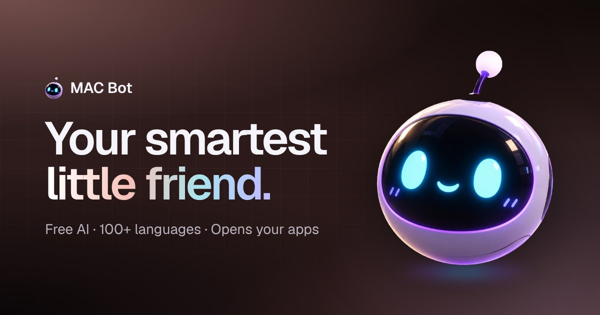

# MAC Bot 🤖 — Your smartest little friend



A premium, dark, mobile-first AI assistant that runs **100% free to start**. It speaks **100+ languages**, opens your apps (WhatsApp, Mail, Calendar, Maps and more), streams answers live, listens to your voice, reads replies aloud, sees images, and has three brains: **Fast**, **Think Deeper** and **Business Mentor**.

Built with Next.js (App Router), Tailwind CSS and Framer Motion. Installable on phones as an app (PWA). Ready for Vercel's free plan.

## ✨ Features

- **Streaming replies** with a smooth typewriter effect, Markdown, tables and code blocks with syntax highlighting and a copy button
- **Memory**: the last ~20 messages go with every question
- **Bots**: MAC Bot, Business Mentor, English Coach, Coding Buddy, Study Tutor, Startup Idea Generator, Fitness Coach and Chef. Each one is the MAC mascot in its own color with a small role badge, and keeps its own chat history
- **Bot creator**: make your own bot (name, avatar, color, personality, greeting), let AI draft its instructions, then export it as a file for friends to import
- **Chat history** saved on your device (localStorage), with rename and delete
- **100+ languages**: the 🌐 button picks the reply language, or leave it on **Auto** and MAC Bot answers in whatever language you write. Arabic, Hebrew, Urdu and Persian display right-to-left
- **Opens your apps**: ask it to message, email, schedule, navigate, play or post. It writes the text, then gives you a button that opens WhatsApp, Telegram, Mail, Messages, Phone, Google Calendar, Google Maps, YouTube, Spotify, Google, X, LinkedIn or Google Translate with everything filled in. Nothing is sent until you tap and confirm
- **Share** any reply to any app on your phone (Instagram, Slack, Notes…) with the share button
- **Voice input** in your language, plus a **read-aloud** button on every reply (it picks a voice that matches the reply's language)
- **Modes**: ⚡ Fast · 🧠 Think Deeper (step-by-step) · 💼 Business Mentor, on top of any bot
- **Knows your local time and currency**: your device's time zone and language go with each question, so "tomorrow 10 AM" and prices come out right wherever you are
- **Image upload** when the AI model supports vision (Gemini does)
- **Friendly errors**: hit the free rate limit and MAC Bot tells you to give it a minute instead of crashing
- **Living mascot**: blinks, glances around, looks down while you type, spins while it thinks and smiles with a bounce when a reply arrives (calmer with "reduce motion" on)
- **Premium "AI" look**: pearl-white buttons on frosted glass, three slow background moods (rose → teal → indigo) and an iridescent ring around the message box while the AI is thinking
- **Installable app** (manifest + service worker), works on a 380px phone first

## 🚀 Quick start (about 5 minutes)

You need [Node.js](https://nodejs.org) 20.9 or newer.

### 1. Get a free API key

Default AI: **Google Gemini** (free tier, no credit card).

1. Open [aistudio.google.com/apikey](https://aistudio.google.com/apikey) and sign in with Google.
2. Click **Create API key** and copy it.

> Tip: use a key from a project **without billing** turned on. Then the worst that can happen is a friendly "rate limit" message — never a surprise bill.

### 2. Add it to `.env.local`

```bash
cp .env.example .env.local
```

Open `.env.local` and paste your key:

```bash
AI_PROVIDER=gemini
GEMINI_API_KEY=paste-your-key-here
```

Your key stays on the server. It is never sent to the browser.

### 3. Run it

```bash
npm install
npm run dev
```

Open [http://localhost:3000](http://localhost:3000) for the landing page, and [http://localhost:3000/chat](http://localhost:3000/chat) to chat.

**Try it on your phone:** connect to the same Wi‑Fi and open `http://YOUR-COMPUTER-IP:3000` (the terminal prints it as "Network"). Voice input, copy buttons and "Install app" need HTTPS, so test those on your Vercel link (below).

## 🔁 Switch AI provider (one env variable)

Every provider uses the same OpenAI-compatible API, so switching is just config. Change `AI_PROVIDER` and add that provider's key:

| `AI_PROVIDER` | Free key | Default model | Images |
| --- | --- | --- | --- |
| `gemini` | [aistudio.google.com/apikey](https://aistudio.google.com/apikey) → `GEMINI_API_KEY` | `gemini-flash-latest` | ✅ |
| `groq` | [console.groq.com/keys](https://console.groq.com/keys) → `GROQ_API_KEY` | `openai/gpt-oss-120b` | ❌ |
| `openrouter` | [openrouter.ai/keys](https://openrouter.ai/keys) → `OPENROUTER_API_KEY` | `google/gemma-4-31b-it:free` | ✅ |
| `custom` | any OpenAI-compatible server (Ollama, LM Studio…) → `CUSTOM_BASE_URL` | `CUSTOM_MODEL` | `CUSTOM_VISION=true` |

- **Auto-fallback:** set `AI_PROVIDER=gemini,groq` with both keys. If Gemini is rate-limited or down, MAC Bot quietly answers with Groq.
- **Change a model:** set `GEMINI_MODEL`, `GROQ_MODEL` or `OPENROUTER_MODEL` (for example `GEMINI_MODEL=gemini-flash-lite-latest`, which usually has higher free limits).
- **OpenRouter model:** the default is `google/gemma-4-31b-it:free`, a Google instruction-tuned model that follows formatting rules well, handles many languages and reads images. For harder reasoning try `OPENROUTER_MODEL=nvidia/nemotron-3-ultra-550b-a55b:free` (slower, text only, so also set `OPENROUTER_VISION=false`). Free models come and go: pick any model ending in `:free` from [openrouter.ai/models](https://openrouter.ai/models?max_price=0).
- Leave `AI_PROVIDER` empty and MAC Bot uses the first provider that has a key.

Restart `npm run dev` after editing `.env.local`. On Vercel, redeploy after changing variables.

## ☁️ Deploy to Vercel (free)

1. Push this project to GitHub.
2. Go to [vercel.com/new](https://vercel.com/new), sign in with GitHub and **Import** the repo. Vercel detects Next.js automatically.
3. Open **Environment Variables** and add the same values as your `.env.local` (`AI_PROVIDER`, `GEMINI_API_KEY`, …).
4. Click **Deploy**. In about a minute you get a live `https://your-app.vercel.app` link.

Prefer the terminal?

```bash
npx vercel                        # first deploy (answer the prompts)
npx vercel env add GEMINI_API_KEY # paste your key, pick all environments
npx vercel --prod                 # deploy again with the key
```

## 📱 Install it on your phone

Open your Vercel link on your phone:

- **Android (Chrome):** tap the **Install** button on the landing page, or ⋮ → **Install app**.
- **iPhone (Safari):** tap **Share** → **Add to Home Screen**.

It opens full-screen with the MAC Bot icon, like a real app.

## 🤖 Bots

Tap **Bots** in the chat header (or in the menu) to switch bots. Every bot keeps its own chat history, and the Fast / Think Deeper / Mentor switch works with all of them.

**Create your own:** Bots → **Create your own bot**. Give it a name, a one-line description, a color (the mascot recolors live), a badge and a personality. Tap **✨ Make it with AI** to have it write the instructions from your one-line description, check the live preview, then save.

**Share a bot:** tap the ⬇ icon on your bot to download it as a `.json` file. A friend opens Bots → **Import**, picks the file, previews it and saves. Custom bots live in the browser only: no database, no login.

## 🌍 Languages and apps

- **Reply language:** tap 🌐 in the message box. **Auto** (the default) answers in the language you write in; picking a language makes every reply use it until you switch. Voice input listens in the same language (or your phone's language on Auto). The list lives in `lib/languages.ts`.
- **App buttons:** when you ask MAC Bot to message, email or schedule something, the AI writes a link like `[Send on WhatsApp](app:whatsapp?text=…)` and the app turns it into a button that opens the real app. The supported apps and how each link is built are in `lib/apps.ts`; the instructions the AI follows are `APPS` in `lib/ai.ts`. The AI can't read your other apps, and nothing is sent until you confirm in that app.

## 🎨 Make it yours

| What | Where |
| --- | --- |
| Built-in bots (names, colors, personalities, starter chips) | `lib/bots.ts` |
| Answer rules for every bot (answer first, be specific, one next step), reply language, app links, the three modes, temperature | `lib/ai.ts` |
| Languages in the 🌐 picker | `lib/languages.ts` |
| App buttons (WhatsApp, Mail, Calendar…) | `lib/apps.ts` |
| Providers and default models | `lib/ai.ts` (`PRESETS`) |
| Friendly error messages | `lib/client.ts` (`ERRORS`) |
| Colors, glass effect, pearl buttons, the thinking ring, animations, the background moods (rose → teal → indigo, 45s loop) | `app/globals.css` |
| Landing page copy | `app/page.tsx` |

The mascot: `public/bot.png` is the original art. `public/mascot-body.webp` plus the two `mascot-eye-*.webp` layers are cut from it, so the eyes can blink and look around. `mascot.webp` is the small avatar. The app icons and share image are made from it too.

## 🗂️ Project structure

```
app/
  page.tsx            Landing page (hero, features, live demo, footer)
  chat/page.tsx       The chat app
  api/chat/route.ts   Streams replies from the AI provider
  layout.tsx          Fonts, metadata, aurora background
  manifest.ts         PWA manifest
components/           Chat, Composer, Sidebar, Message, Markdown, Mascot, Bots, BotEditor, DemoChat, Pwa
lib/ai.ts             Providers + shared rules, reply language, app links and modes (server only)
lib/apps.ts           App buttons: turns the AI's app: links into WhatsApp, Mail, Calendar, Maps… links
lib/bots.ts           Built-in bots + bot file import/export
lib/languages.ts      The 100+ reply languages (shared)
lib/client.ts         Chat & bot storage, typewriter, voice in any language, images, friendly errors (browser)
public/sw.js          Service worker (offline app shell)
```

## 🛟 Troubleshooting

- **"My brain isn't plugged in yet 🔌"**: there's no API key. Check `.env.local`, then restart `npm run dev`.
- **"That's a lot of brainpower in one minute 😮‍💨"**: you hit the provider's free limit. Wait a minute, or add a fallback (`AI_PROVIDER=gemini,groq`). Free limits change often: see [Gemini rate limits](https://ai.google.dev/gemini-api/docs/rate-limits) and [Groq rate limits](https://console.groq.com/docs/rate-limits).
- **"That AI model isn't available anymore"**: providers retire models. Set a current model with `GEMINI_MODEL` / `GROQ_MODEL` / `OPENROUTER_MODEL`.
- **No mic button**: your browser doesn't support speech recognition (Firefox doesn't). Use Chrome, Edge or Safari over HTTPS.
- **Read-aloud uses the wrong accent**: your device has no voice for that language. Pick the language with 🌐, or add a voice in your phone's text-to-speech settings.
- **No share button**: your browser doesn't support sharing (most desktop browsers on Linux don't). Copy the reply instead.
- **No image button**: the current model can't see images. Use Gemini or OpenRouter.
- **Chats disappeared**: history lives in this browser only. Clearing site data or using another browser starts fresh.

---

Made for curious minds everywhere 🌍
